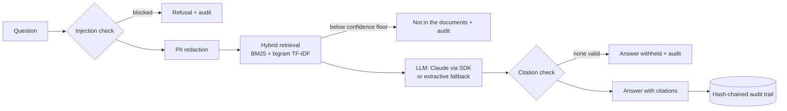

# BFSI RAG Assistant

Grounded question answering over a bank's product and policy documents, built the way a regulated
bank would need it: **every answer cites its source, personal data never reaches the model, injected
instructions are refused, every exchange is in a tamper-evident audit trail, and retrieval quality is a
build gate.**

Spring Boot 3 · Java 17 · Anthropic Claude (official Java SDK) · 33 tests, no API key needed to run them.

> The corpus is a **fictional "Demo Bank"** written for this project (payment cut-offs, maker-checker,
> liquidity sweeps, KYC, exceptions). It is illustrative only - not any real bank's policy.

## What it does

```
POST /api/ask {"question": "How many checkers approve a Rs 3 crore payment?"}

{
  "answer": "Payments above Rs 25,00,000 and up to Rs 5 crore need two checkers, at least one of whom
             holds the Senior Authoriser role [1].",
  "grounded": true,
  "citations": [{"number": 1, "document": "Demo Bank - Maker-Checker Authorisation Policy",
                 "section": "Approval matrix", "score": 0.61, "excerpt": "Payments up to Rs 25,00,000 ..."}],
  "flags": [],
  "model": "claude:claude-opus-5-5",
  "auditSeq": 42,
  "latencyMs": 1830
}
```

## Architecture



| Package | Responsibility |
|---|---|
| `ingest` | Markdown → overlapping chunks along paragraph boundaries, each tagged with its section heading |
| `index` | `HybridIndex`: BM25 over word tokens blended with TF-IDF cosine over words + bigrams; a single 0..1 score |
| `guard` | `PiiRedactor` (PAN, Aadhaar, Luhn-checked cards, account numbers, IFSC, phone, email), `PromptInjectionDetector` |
| `llm` | `LlmClient` with `ClaudeClient` (Anthropic Java SDK) and `ExtractiveClient` (deterministic, offline) |
| `answer` | `AnswerService`: the pipeline above, in that order |
| `audit` | `AuditTrail`: SHA-256 hash chain; `verify()` finds the first edited or deleted entry |
| `web` | `POST /api/ask`, `POST /api/documents`, `GET /api/stats`, Actuator health/metrics |

## Design decisions

1. **Refuse rather than improvise.** Three gates turn into an explicit "not in the documents": retrieval
   below the confidence floor, the model replying `NOT_IN_SOURCES`, and an answer with no valid
   citation. For bank staff a confident wrong cut-off time is worse than no answer.
2. **Citations are verified, not trusted.** The model must cite `[n]`; the service removes any number
   that does not match a supplied source (flag `citations-repaired`) and withholds an answer left with
   none (`uncited-answer-withheld`).
3. **PII is masked before anything leaves the service** - the model, the logs and the audit trail only
   ever see `[ACCOUNT]`, `[PAN]`, ... Masking order is specific-first; cards are Luhn-checked so amounts
   and reference numbers survive.
4. **Hybrid lexical retrieval over a vector database, for now.** Banking questions hinge on exact rare
   terms (RTGS, IFSC, maker-checker) where BM25 is strong; bigram cosine adds phrase matching. A
   weighted blend gives an absolute score to refuse on (reciprocal rank fusion ranks well but does not).
   `HybridIndex` has a two-method surface so pgvector or OpenSearch k-NN can replace it; at scale, the
   blend becomes BM25 + embeddings with the same threshold logic.
5. **Degrade, don't fail.** The SDK retries 429/529/5xx; if Claude is still unreachable the extractive
   answer is returned, flagged `degraded-to-extractive`. Server-side refusal fallback
   (`fallbacks: "default"`) is enabled so a declined request is re-run on a suitable model in the same
   call; a refusal that survives is reported as "not in the documents", never as content.
6. **Effort is set explicitly** (`medium` by default): grounded Q&A over four chunks rarely needs deeper
   reasoning, and effort is the main cost/latency lever.
7. **Tamper-evident audit.** Each entry hashes its content plus the previous hash, so editing or deleting
   any past exchange is detectable - the same idea as a hash-chained transaction audit log.
8. **Retrieval quality is a test.** `RetrievalEvalTest` runs 15 golden questions and fails the build if
   hit@1 < 0.85 or hit@3 < 1.0 (currently 1.00 / 1.00), so a tokenizer or chunking change that quietly
   hurts recall cannot ship.

## Run it

```bash
mvn test                                   # 33 tests, offline
mvn spring-boot:run                        # extractive mode - no key, no network
ANTHROPIC_API_KEY=sk-ant-... mvn spring-boot:run          # Claude (claude-opus-5-5, effort medium)

curl -s localhost:8080/api/ask -H 'Content-Type: application/json' \
     -d '{"question":"When do end-of-day sweeps run?"}'
curl -s localhost:8080/api/stats           # documents, chunks, audit entries, chain intact?
```

Configuration (`application.yml` or environment): `RAG_LLM_PROVIDER` (`auto` | `claude` | `extractive`),
`RAG_LLM_MODEL`, `RAG_LLM_EFFORT`, `RAG_AUDIT_FILE` (append the audit trail to a file).

Docker: `docker build -t bfsi-rag . && docker run -p 8080:8080 -e ANTHROPIC_API_KEY bfsi-rag`

## What production would add

Persistent index and audit store (PostgreSQL + pgvector), document-level access control propagated into
retrieval, embedding-based retrieval alongside BM25, answer-quality evals with an LLM judge on a held-out
set, prompt caching of the system prompt, rate limiting per user, and OpenTelemetry traces per stage.
