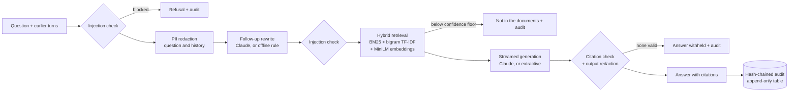

# BFSI RAG Assistant

[](https://github.com/nasable1/bfsi-rag-assistant/actions/workflows/ci.yml)

Grounded question answering over a bank's product and policy documents, built the way a regulated
bank would need it: **every answer cites its source, personal data never reaches the model, injected
instructions are refused, every exchange is in a tamper-evident audit trail, and both retrieval and
answer quality are build gates.**

Spring Boot 3.5 · Java 17 · Anthropic Claude (official Java SDK) · hybrid lexical + semantic search
(in-process embeddings, optional pgvector) · Postgres or H2 · web UI · 100 tests, no API key needed.

> The corpus is a **fictional "Demo Bank"** written for this project (payment cut-offs, maker-checker,
> liquidity sweeps, KYC, exceptions). It is illustrative only - not any real bank's policy.

## What it does

- **Ask in plain language** - in the web UI (`http://localhost:8080`) or over the API - and get an
  answer with numbered citations to the document, section and (for PDFs) page.
- **Follow-up questions** - "and above Rs 5 crore?" is understood in the context of the conversation.
- **Streaming** - text appears as it is written; the checked answer then replaces the draft.
- **Upload PDF, Word, Markdown or text** - searchable immediately; re-uploading the same id replaces it.
- **Refuses rather than guesses** - a question the documents do not cover gets "not in the documents".

```
POST /api/ask   X-API-Key: <user key>
{"question": "How many checkers approve a Rs 3 crore payment?"}

{
  "question": "How many checkers approve a Rs 3 crore payment?",
  "answer": "Payments above Rs 25,00,000 and up to Rs 5 crore need two checkers, at least one of whom
             holds the Senior Authoriser role [1].",
  "grounded": true,
  "citations": [{"number": 1, "documentId": "maker-checker-policy",
                 "document": "Demo Bank - Maker-Checker Authorisation Policy",
                 "section": "Approval matrix", "score": 0.61, "excerpt": "Payments up to Rs 25,00,000 ..."}],
  "flags": [],
  "model": "claude:claude-opus-5-5",
  "auditSeq": 42,
  "latencyMs": 1830
}
```

## Quality, measured

Two evaluation gates run on every build (`mvn test`) and fail it if quality drops:

| Gate | What it checks | Bar | Now |
|---|---|---|---|
| Retrieval (`RetrievalEvalTest`) | 15 questions: is the right document ranked first / in the top 3? | hit@1 ≥ 0.85, hit@3 = 1.0 | **1.00 / 1.00** |
| Answers (`AnswerEvalTest`) | 46 questions through the full pipeline: 29 direct, 4 reworded, 3 follow-ups, 10 the documents do not cover | see below | |
| | answered (in scope) | ≥ 0.95 | **1.00** |
| | fact accuracy - every expected figure or name is in the answer | ≥ 0.90 | **1.00** |
| | citation accuracy - the answer cites the right document | ≥ 0.95 | **1.00** |
| | refusal accuracy - out-of-scope questions are declined | = 1.00 | **1.00** |

The offline scores use the extractive answerer (it quotes source sentences, so it cannot invent).
The same golden set runs against Claude on demand - it costs API credits, so it is opt-in:

```bash
ANTHROPIC_API_KEY=sk-ant-... mvn test -Dtest=ClaudeAnswerEvalTest -Deval.claude=true
```

or from GitHub: *Actions → CI → Run workflow → claude-eval* (uses the `ANTHROPIC_API_KEY` secret).
Reports land in `target/eval/` and as a CI artifact.

**Caveat:** the retrieval blend and the refusal threshold were tuned on this same golden set, so the
offline scores are an upper bound. Add questions from real users before trusting the threshold on a
new corpus.

## Architecture



| Package | Responsibility |
|---|---|
| `ingest` | `DocumentParser` (PDF page by page, Word headings and tables, Markdown, text) → `Chunker` (paragraph-aligned, overlapping, never across a page) → `DocumentService` (stores text in the database, indexes it) |
| `index` | `LexicalIndex` (BM25 + bigram cosine), `MiniLmEmbedder` (all-MiniLM-L6-v2, in-process ONNX) wrapped by `GlossaryEmbedder` (spells out NEFT, RTGS, IMPS...), `InMemoryVectorStore` / `PgVectorStore`, and `Retriever`, which blends them into one 0..1 score |
| `guard` | `PiiRedactor` (PAN, Aadhaar, Luhn-checked cards, account numbers, IFSC, UPI ID, phone, email), `PromptInjectionDetector` |
| `llm` | `LlmClient` with `ClaudeClient` (Anthropic Java SDK, streaming) and `ExtractiveClient` (deterministic, offline) |
| `answer` | `AnswerService`: the pipeline above, in that order; `QueryRewriter` for follow-ups |
| `audit` | `AuditTrail`: SHA-256 hash chain in the database, streaming verification, external checkpoints |
| `security` | API keys with USER / ADMIN roles, per-caller rate limit |
| `web` | REST API, Server-Sent Events, the single-page UI in `resources/static` |

## Design decisions

1. **Refuse rather than improvise.** Three gates turn into an explicit "not in the documents":
   retrieval below the confidence floor, the model replying `NOT_IN_SOURCES`, and an answer with no
   valid citation. For bank staff a confident wrong cut-off time is worse than no answer.
2. **Citations are verified, not trusted.** The model must cite `[n]`; the service removes any number
   that does not match a supplied source (flag `citations-repaired`) and withholds an answer left
   with none (`uncited-answer-withheld`).
3. **PII is masked before anything leaves the service** - questions, the earlier turns sent with a
   follow-up, uploaded documents (before they are stored), and the model's own output, including the
   streamed draft (redacted a sentence at a time, so no identifier is split). The model, the logs and
   the audit trail only ever see `[ACCOUNT]`, `[PAN]`, ...
4. **Hybrid retrieval.** Banking questions hinge on exact rare terms (RTGS, IFSC, maker-checker), where
   BM25 is strong; embeddings find the passage when the wording differs ("can one person both enter
   and approve a transaction?"). Neither alone separates answerable from unanswerable questions on
   the eval set - keyword-only scores an off-topic "home loan interest rate" question above some real
   ones - while the blend separates them cleanly (in scope ≥ 0.37, out of scope ≤ 0.24, refusal floor
   0.30). Embeddings run in-process: no API key, no per-query cost, and questions never go to an
   embedding provider. A small glossary spells out acronyms the general-purpose model does not know.
5. **Follow-ups are rewritten, not replayed.** The client sends earlier turns; they are used only to
   rewrite the question into a standalone one (by Claude at low effort, or an offline rule), which is
   then checked for injection again, searched, answered and audited. Client-supplied history is never
   shown to the model as its own past answers.
6. **Streaming without trusting the stream.** Drafts are shown as they arrive, but the citation check,
   refusal handling and redaction run on the complete message, whose result replaces the draft. With
   server-side refusal fallback (`fallbacks: "default"`), a partial answer can be continued by another
   model in the same stream - the final message accounts for that.
7. **Degrade, don't fail.** The SDK retries 429/529/5xx and connection errors; if Claude is still
   unreachable, or an answer is cut off by `max_tokens`, the extractive answer is returned, flagged
   `degraded-to-extractive`. If the embedding model cannot load on a platform, search continues
   lexically.
8. **Effort is set explicitly** (`medium` for answers, `low` for rewriting a follow-up): grounded Q&A
   over four chunks rarely needs deeper reasoning, and effort is the main cost/latency lever.
9. **Tamper-evident, append-only audit.** Each entry hashes its content plus the previous hash, so an
   edited or deleted entry is found by `GET /api/audit/verify`. On Postgres, triggers make the table
   append-only. Deleting the *newest* entries leaves a valid shorter chain, so two more checks cover
   the tail: the running service knows the head it wrote, and an external system can record
   `GET /api/audit/head` as a checkpoint and confirm it later with `POST /api/audit/checkpoint`.
10. **Least privilege.** USER keys can ask; only ADMIN keys can change documents or read the audit.
    Each caller is rate-limited (every question may cost a model call). The UI is served with a strict
    Content-Security-Policy and renders all server text as text, never HTML.

## Run it

**Locally** (Java 17; H2 database file in `./data`, no other install):

```bash
mvn test                                   # 100 tests (the Postgres ones run when Docker is available)
export RAG_ADMIN_KEY=$(openssl rand -base64 24) RAG_USER_KEY=$(openssl rand -base64 24)
mvn spring-boot:run                        # extractive mode - no Anthropic key, no network
ANTHROPIC_API_KEY=sk-ant-... mvn spring-boot:run   # Claude (claude-opus-5-5, effort medium)
```

Open `http://localhost:8080`, paste a key, ask. (If you set no keys, random ones are generated and
printed in the log - fine on a laptop, never in production.)

**With Postgres + pgvector** (Docker):

```bash
cp .env.example .env                        # set RAG_ADMIN_KEY, RAG_USER_KEY (16+ chars), optionally ANTHROPIC_API_KEY
docker compose up --build
```

**Deploy to Render**: `render.yaml` is a Blueprint (web service + managed Postgres; keys generated
for you). Check plan sizes first: the service uses about 400 MB with the embedding model loaded, so a 512 MB instance is too tight.

### API

| Method & path | Role | |
|---|---|---|
| `POST /api/ask` | USER | `{"question": "...", "history": [{"question","answer"}...]}` → answer JSON |
| `POST /api/ask/stream` | USER | same body; Server-Sent Events: `delta` (draft text), then `answer` (checked) or `error` |
| `GET /api/me`, `GET /api/stats`, `GET /api/documents` | USER | caller, index and audit status, document list |
| `POST /api/documents` | ADMIN | `{"id": "...", "markdown": "..."}` |
| `POST /api/documents/upload` | ADMIN | multipart `file` (.pdf .docx .md .txt, ≤ 20 MB), optional `id` |
| `DELETE /api/documents/{id}` | ADMIN | |
| `GET /api/audit`, `/api/audit/{seq}`, `/api/audit/head`, `/api/audit/verify` | ADMIN | |
| `POST /api/audit/checkpoint` | ADMIN | `{"seq": n, "hash": "..."}` → `{"valid": true/false}` |
| `GET /actuator/health` | public | liveness/readiness probes under `/health/*` |
| `GET /actuator/prometheus`, `/actuator/metrics` | ADMIN | send the key as `Authorization: Bearer <key>` |

Keys go in `X-API-Key: <key>` or `Authorization: Bearer <key>`.

### Metrics

`rag_answers_total{outcome, model}` (answered, not-found-retrieval, not-found-model, withheld, blocked),
`rag_guardrail_flags_total{flag}`, `rag_answer_latency_seconds` (histogram), `rag_index_chunks`,
`rag_index_documents`, plus the standard JVM and HTTP metrics.

### Configuration

| Setting (env) | Default | |
|---|---|---|
| `RAG_ADMIN_KEY`, `RAG_USER_KEY` | generated (logged) | API keys, 16+ characters; more callers in `rag.security.api-keys` |
| `ANTHROPIC_API_KEY` | - | answers come from Claude when set (`RAG_LLM_PROVIDER=auto`) |
| `RAG_LLM_PROVIDER` | `auto` | `auto`, `claude` or `extractive` |
| `RAG_LLM_MODEL`, `RAG_LLM_EFFORT` | `claude-opus-5-5`, `medium` | |
| `RAG_SEMANTIC_WEIGHT` | `0.6` | 0 = keyword search only |
| `RAG_VECTOR_STORE` | `memory` (`pgvector` with the `postgres` profile) | |
| `RAG_DB_URL` / `RAG_DB_HOST`, `RAG_DB_PORT`, `RAG_DB_NAME`, `RAG_DB_USER`, `RAG_DB_PASSWORD` | H2 file `./data/rag` | `SPRING_PROFILES_ACTIVE=postgres` for Postgres |
| `RAG_ASKS_PER_MINUTE` | `30` | per caller, per instance |

## Known limitations

- The extractive (offline) answerer quotes up to three source sentences; it can include a sentence
  that is related but not needed. Claude answers are more precise.
- The rate limit is per instance; behind several instances add a shared limit at the gateway.
- The H2 default is for a single local instance. Use Postgres for anything shared.
- Bundled corpus documents are re-added at start-up if deleted (uploads with the same id win).
- The jar is ~220 MB and the image ~860 MB, mostly ONNX Runtime's native libraries for every platform.
- A Postgres superuser can drop the append-only triggers; external checkpoints of the audit head are
  what make tampering by a database administrator detectable.

## License

MIT - see [LICENSE](LICENSE).
